## What's New
As of November 2026
* Now featuring a [LinkedIn profile](https://www.linkedin.com/in/radoslaw-glasek/?locale=en-US) ✨
  

    
  

## Hi there 👋

If God isn't watching, who is?

> I just wanted to ask you something.
>
> If God isn't watching, who is?
>
> _He he he he_
>
> You wanted to know, haven't you?
>
> The answer might leave you hollow.
>
> Every atrocity, every mishap, every injustice you pretend to care about — but you don't. We merely want attention from
> all we can't control.
>
> If you controlled it all, would you want people to know?
>
> Gods were not imagined to hear praise, but to deflect blame.
>
> Who made all those choices resulting in death, destruction, addiction, and despair?
>
> Why you're lonely, out of shape, unfulfilled?
>
> The answer is you.
>
> _He he he he._
>
> Now, what are you gonna do about it?
>
> Goodbye God, I need to go now...

- Specializing in CAD/CAM Systems Design (5th year Computer Science student) at
  the [Faculty of Mathematics and Information Science](https://ww2.mini.pw.edu.pl/)
  at [Warsaw University of Technology](https://www.pw.edu.pl/)
- Linux enjoyer :penguin:
- Feel free to contact me via:
    - Email: [radoslaw.glasek@theworldlooksback.com](mailto:radoslaw.glasek@thundermail.com)
    - Discord: [rdkgsk](https://discord.com/users/523157645667074048)

### Technologies / Languages I use / am learning

    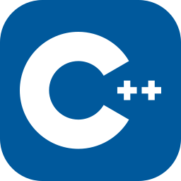
    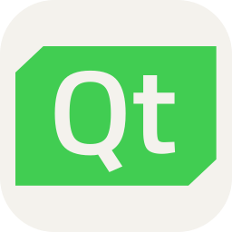

A bit rusty:

    
    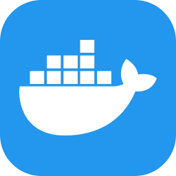
    
    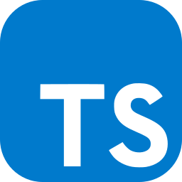
    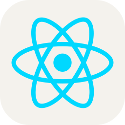
    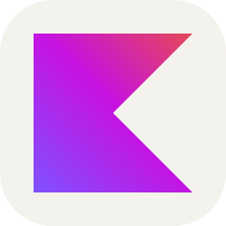
    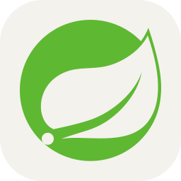
    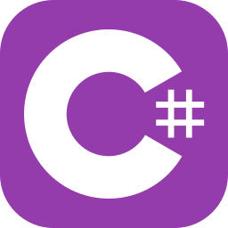
    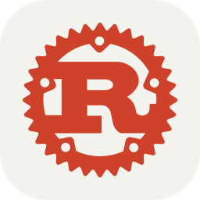
    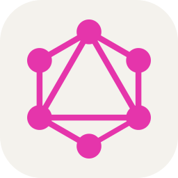
    

### Tooling

JetBrains IDEs, git, vim motions, LaTeX (note taking / uni reports).

    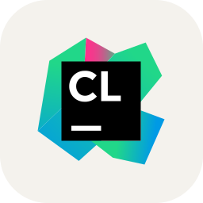
    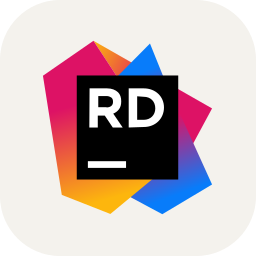
    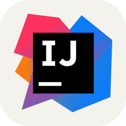
    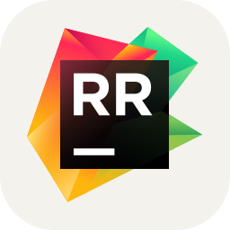
    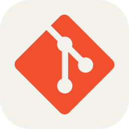
    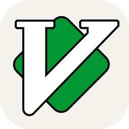
    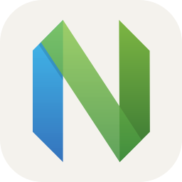
    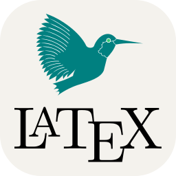

### Other

#### OS

Gaming on Windows, for personal stuff Linux. I have also previously worked on mac.

    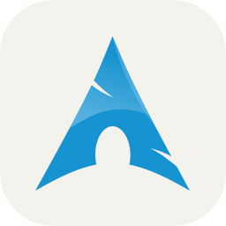
    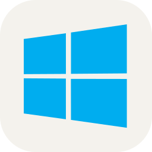
    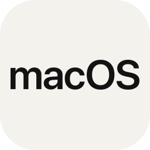

#### AI

[Claude](https://claude.ai/) or [Codex](https://chatgpt.com/) for best value for
money, [openrouter](https://openrouter.ai/) for some of the stuff and experiments.

#### Wanna see games I play?

Checkout my [Steam profile](https://steamcommunity.com/id/rdkgsk/)

---

## Featured Projects

- [Cad](https://github.com/1180779/cad) &ndash; CAD/CAM from scratch
- [Cloths and Cubes](https://github.com/1180779/cloths-and-cubes) &ndash; simple physics engine from scratch
- [PayUpPal](https://github.com/adamgracikowski/PayUpPal) &ndash; simplify group expense sharing
- [Spheres raycasting](https://github.com/1180779/SpheresRaycasting) &ndash; spheres raycasting in c++/CUDA/openGL

## Currently working on

- Masters degree
- Getting better at touch typing and vim motions (IdeaVim) :keyboard:

## Other stuff

- My LaTeX [neovim setup](https://github.com/1180779/nvchad-starter) :scroll:
